# AstroPlanner

**Explore. Capture. Discover.** An astrophotography planner built around one question:
*which targets will actually be above my horizon during real darkness tonight, and when?*
It is tuned first for the **ZWO Seestar S30** (original, not the S30 Pro).

## Homescreen

`/` is a landing page that tells the story before you touch a tool: the headline first, then a real
capture (the developer's Andromeda Galaxy), then **one night, scrolled**. A sticky clock moves from sunset
(16:48) through astronomical darkness (18:21) to sunrise (06:41) while the page sky darkens, and each
stop shows one part of the app (Tonight, Explore, AstroLog, Processing Coach, Variable Hunter). A gallery
of real captures follows, then **Clear skies tonight?**: type a city and it opens Tonight for that place.
It reuses a saved location within 1 km, never guesses a timezone, and hands the place to Settings if none
can be found. The times come from a saved example night (Philadelphia, 10 Nov) and are labelled as such; the
landing page shows no live data. Its AstroLog and Processing Coach pictures are the developer's own Bubble and
Dumbbell nights (11 Sept). Tonight itself now lives at **`/tonight`**.

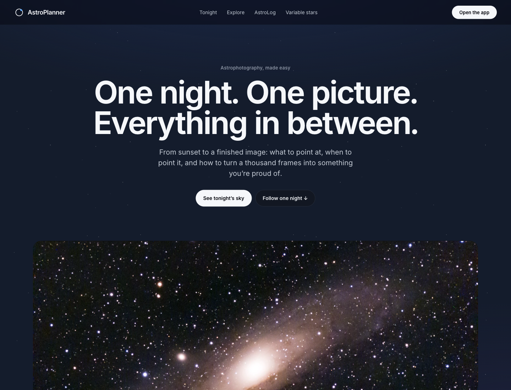

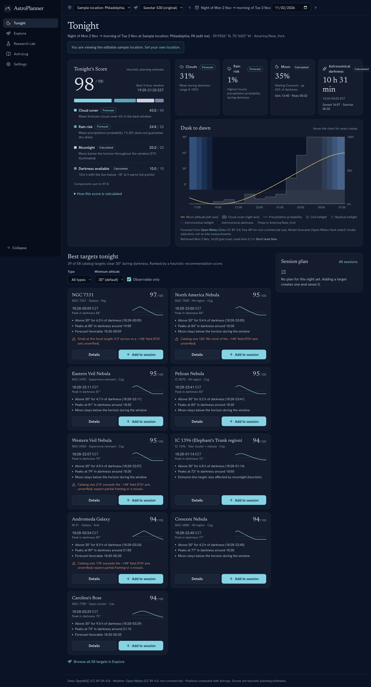

### Site pages

Four plain pages sit beside the homescreen: `/how-it-works` (what each score and number is built from),
`/privacy` (what stays on your machine), `/credits` (data sources, licenses and acknowledgments) and
`/terms` (a plain-language draft, not legal advice). They share the homescreen's header and footer and
render outside the app shell. The app's footer links to How it works and Privacy.

## Accounts

**Session plans, AstroLog and the Processing Coach need an account**: each person sees only their own plans, nights,
library, final pictures and processing notes, and only their own Variable Hunter progress and "stacked" badges.
Everything else works signed out: the homescreen, the site pages, Tonight's sky, score and targets, Explore,
Variable Hunter star pages and Settings. The header's **Sign in** link (or your initial, with a menu for AstroLog,
Account and Sign out) is in the top right of every page except the sign-in pages themselves.

- **Local accounts.** The backend stores accounts itself, in the same database as everything else, so sign-in works
  offline on your computer: an email, an Argon2id password hash (never the password) and sign-in sessions (the
  browser holds the session token in an HttpOnly cookie; only its hash is stored). Supabase Auth replaces this at
  deployment (see [ROADMAP.md](ROADMAP.md)).
- **The first account created on an install takes over the plans and AstroLog library that existed before accounts**,
  once; the Account page says so. No later account ever sees them.
- **Forgot your password?** There is no email sender, so it is reset from the terminal (it asks for the new password):

  ```bash
  cd backend && .venv/bin/python -m app.accounts reset-password you@example.com
  ```

- **Account page** (`/account`): your email and when the account was created, change password (other devices are
  signed out; this one stays signed in), sign out, and **delete account**. Deleting asks for your password and a typed
  `DELETE`, then removes the account, its sign-in sessions, its session plans and nights, its AstroLog library, its
  processing notes and their preview files. Your original files on your computer are never touched.
- **Saved places and equipment are shared**, not per account, in this build: anyone using the app can edit them, and
  editing a place changes the times computed for nights planned there (see PROGRESS, known limitations).
- **Same origin only.** The session cookie needs the app and the API on one origin: the Vite dev proxy, the e2e
  servers and single-process mode all are. Cross-origin `VITE_API_BASE` mode is not supported with accounts in this
  build.

## What it does (Phase 1)

- **Tonight:** a 0–100 **Tonight's Score** with every component shown (cloud 45, rain 25,
  Moon 20, darkness 10), whether each is *forecast* or *calculated*, and the best 2-hour
  window. The dusk-to-dawn timeline shows twilight bands, Moon altitude and hourly cloud and
  precipitation. With no forecast, there is **no total**, only clearly labelled partial
  indicators.
- **Recommendations:** 58 deep-sky targets from OpenNGC, ranked by a transparent heuristic.
  Each shows its real observing window, peak altitude, Moon separation, 2–4 reasons and
  cautions (including S30 framing notes).
- **Explore:** search and filter the full catalog. A detail drawer shows the
  altitude-vs-local-time chart, coordinates, rise/set and the score breakdown.
- **Sessions:** create a plan for a night; add, reorder and remove targets; it persists in the database.
- **Settings:** city search or manual coordinates with timezone detection (opt-in browser
  geolocation), the read-only **verified S30 preset** plus custom equipment, and observing
  preferences (minimum altitude, astronomical vs nautical darkness).
- **Night vision:** one toggle turns the whole app dim red to protect dark-adapted eyes at the telescope: text, charts, pictures, popups and checkboxes. Ten native selects (Settings, AstroLog) still open a browser-drawn list that cannot be themed.
- **Phone:** target details open as a bottom sheet you can drag down to close; Tonight leads with the score tied to what it covers and a one-line statement about the whole night.

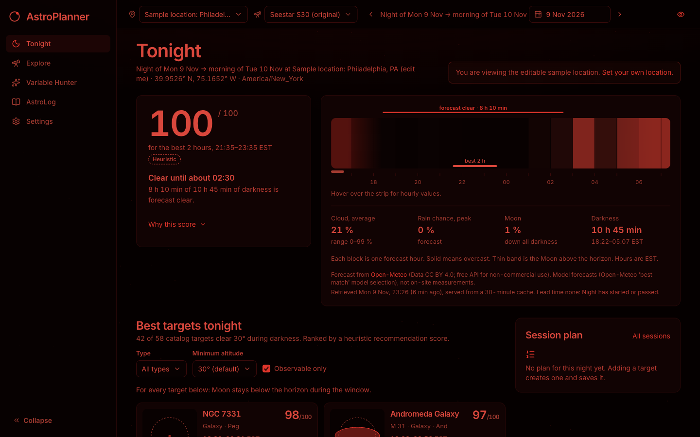

## AstroLog (Phase 2)

A target-first library of what you have actually shot. Import a folder of **Seestar S30 FITS**
or **Canon CR2** files and AstroLog reads only each file's header: in your browser, never the
image data. It groups frames into nights (local noon to noon) and capture sets, and shows for
every target the **time in the final stack** (or the **captured** time, labelled as such) beside
your finished picture.

- **Library** (`/astrolog`): one tile per target with the final picture, headline time and number of nights.
- **Target page:** final picture, time on target, "654 of 1,012 frames used" when the stack's frame range is known
  (the denominator is the captured frames inside that stack's EXPSTART–EXPEND), header-derived facts with the header
  key each came from (Canon: camera, lens, exposure, ISO, f-number, focal length from EXIF), and the nights that
  contributed with their local first → last frame times and per-frame exposure. Upload a final picture
  (JPEG, PNG, TIFF or FITS, up to 150 MB) and link it to the stack it came from. Only a
  metadata-free preview (about 1600 px) and a thumbnail are kept.
- **Import** (`/astrolog/import`): choose or drop a folder, review what was found, then commit. Re-importing a
  folder after adding frames adds only the new ones; nothing doubles. Unreadable files are listed as skipped with a reason.
- **Nights** (`/astrolog/nights`): sessions as logs, attached to a plan you made in Tonight when one matches. Planned targets you did not shoot are shown as "not shot". A night with imported captures can't be deleted.
- **Unsorted:** there is one Unsorted group. "Move to Unsorted" on a custom target merges it into that group.
- **Planner badge:** Tonight and Explore cards show "You have 1 h 49 m stacked" (or "captured") for targets already in your library.
- **Privacy:** coordinates inside files are used only to pick a saved location and are never stored or returned.
  Unknown values stay "unknown"; nothing is estimated. Stacks are never summed.

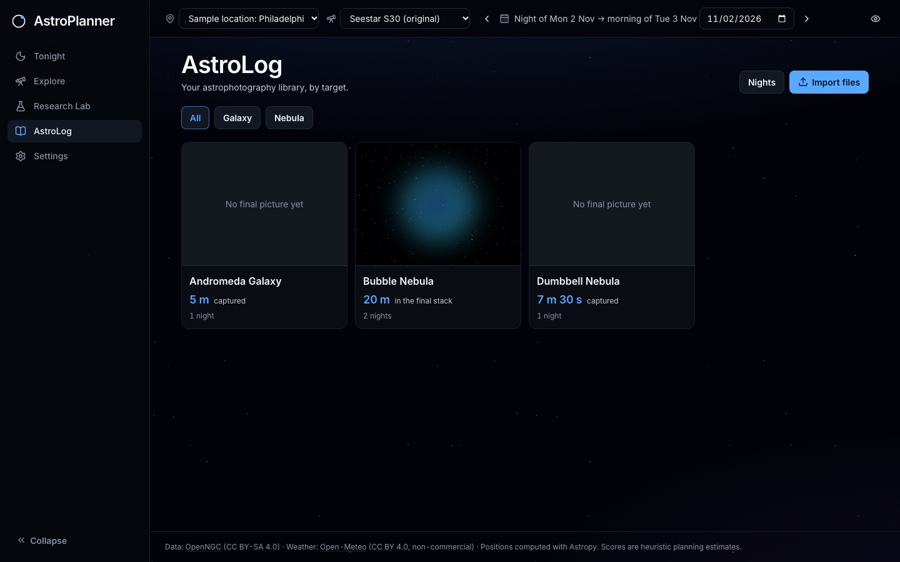
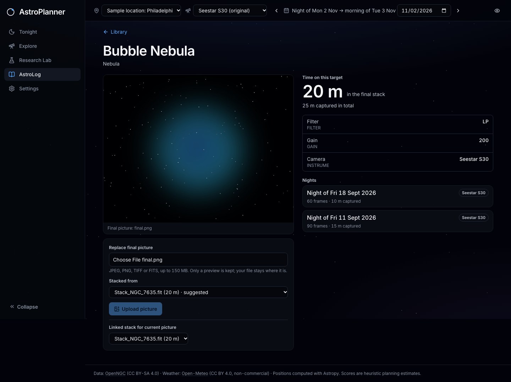

## Variable Hunter (Phase 3)

A short, curated list of variable stars a Seestar can follow: **SS Cygni, U Geminorum, T Coronae Borealis, R Leonis**
(`/variables`; the old `/research` address redirects there).

- **Star page** (`/variables/:slug`): type and VSX magnitude range, tonight's window above your minimum altitude
  (calculated for your saved location), your own nights from AstroLog, and a link to the star's AAVSO VSX page.
- **Missions** (weekly watch, follow the cycle) are counted from your own AstroLog nights.
- **Seestar fit** uses an **estimated** S30 brightness range of 7 to 12.5, labelled "estimate, not yet measured".
- Add a star to tonight's plan, or link an imported AstroLog target to one of the curated stars.

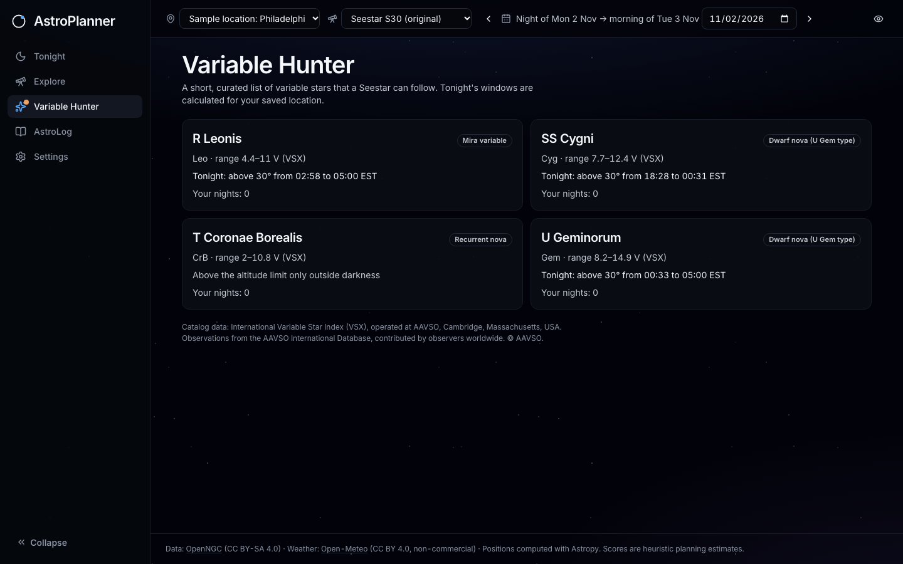
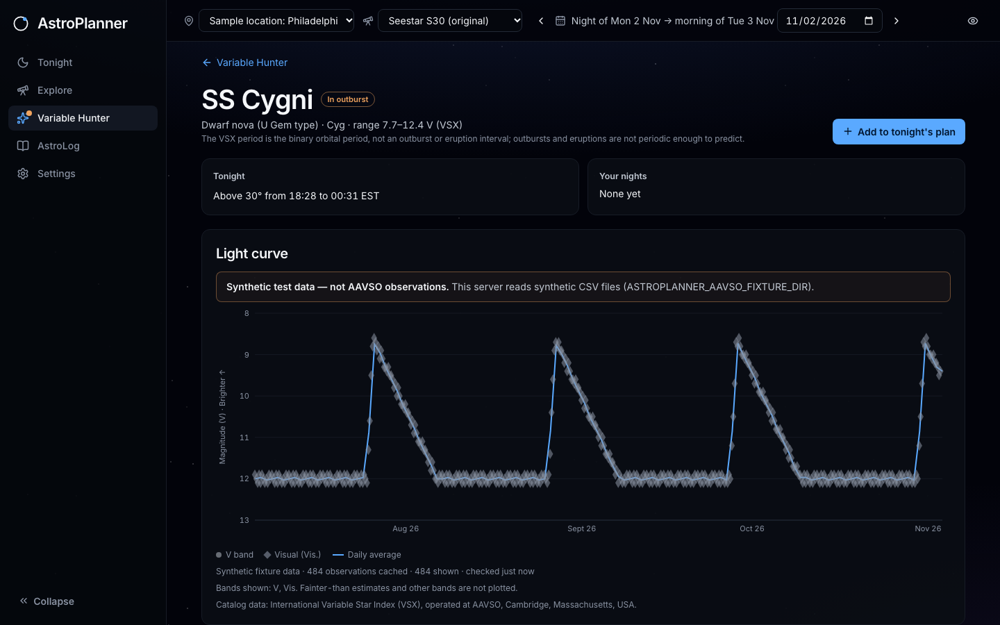

**No AAVSO observations.** AstroPlanner uses only the VSX catalog facts for these four stars (fetched once by
`backend/scripts/build_variables.py`); it draws no light curve and sends no outburst alerts. A live AAVSO layer
(light curves from the AAVSO International Database, sky alerts) was built and then removed before merge: VSX's
copyright page allows personal, non-commercial use only, and neither AAVSO's Data Usage Guidelines (2026-07-16) nor
its forum API notes say whether a third-party app may download and display observations. That code is kept on the
`aavso-live-layer` branch. A later phase (Phase 5, image analysis) will plot your own brightness measurements instead, which need nobody's permission.

Attribution shown with the catalog facts: "Catalog data: International Variable Star Index (VSX), operated at AAVSO,
Cambridge, Massachusetts, USA."

## Processing Coach (Phase 4)

A step-by-step guide for processing one night of **Seestar S30** frames in **Siril**, built from numbers Siril itself
wrote. Open a night from its target page ("Process this night"; `/astrolog/process/:captureSetId`).

- **Night report:** choose the night folder (the one containing `lights/` and Siril's working folder). Only Siril's
  `.seq` and `*_conversion.txt` text files are read, in your browser; light frames are never opened. You get frames
  captured / aligned / in your stack, a frames-per-half-hour chart in the observer's timezone, and fixed-rule findings
  (frames that could not be aligned, the roundness cut Siril applied, a time split, stars per frame), each tagged
  measured or heuristic.
- **Choose frames:** up to four options, each with the exact number of frames and integration time it keeps. Nothing
  is pre-selected.
- **Scripts:** download the coach's two Siril scripts (prepare, then stack). They write only into a new
  `process-coach/` folder beside `lights/` and state the disk they will use first.
- **Stack advice:** add your finished Siril stack (FITS) and the coach measures it on your computer: star size, noise,
  background gradient and colour balance feed the background, colour and stretch steps. Only the numbers and a small
  preview are kept.
- **Compare:** your final picture beside the Seestar's, and (measured the same way) the two stacks side by side.
  There is no score and no winner.

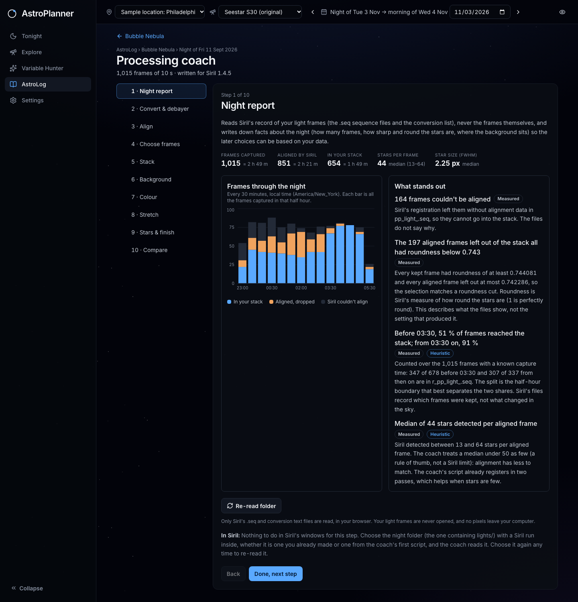
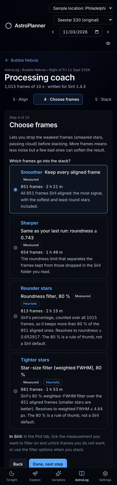
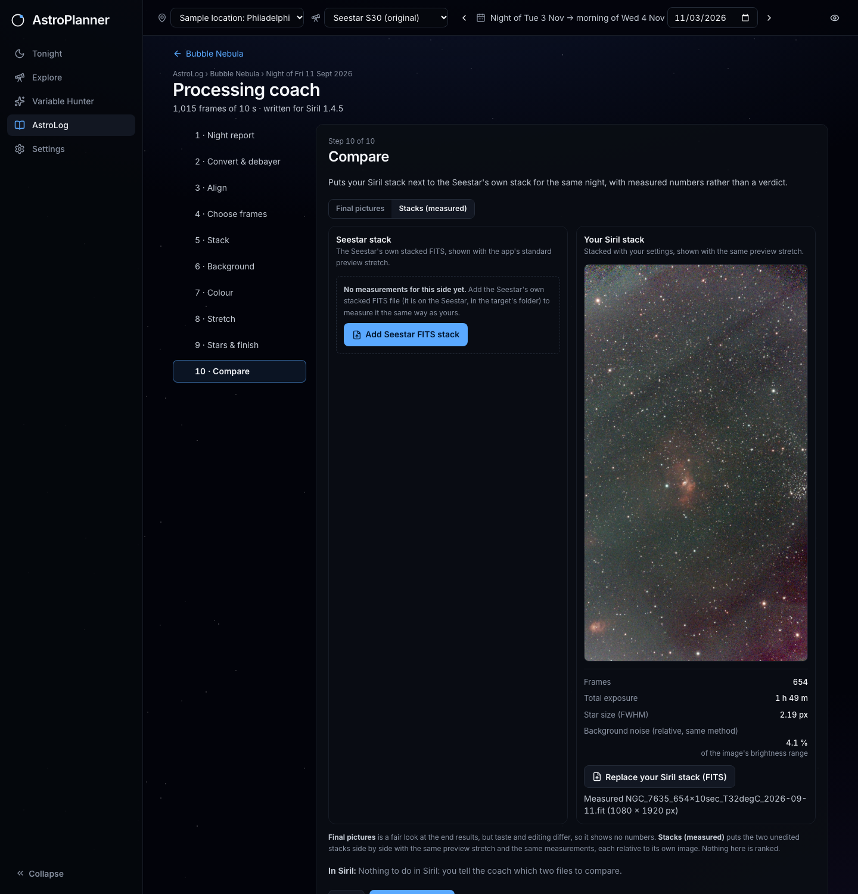
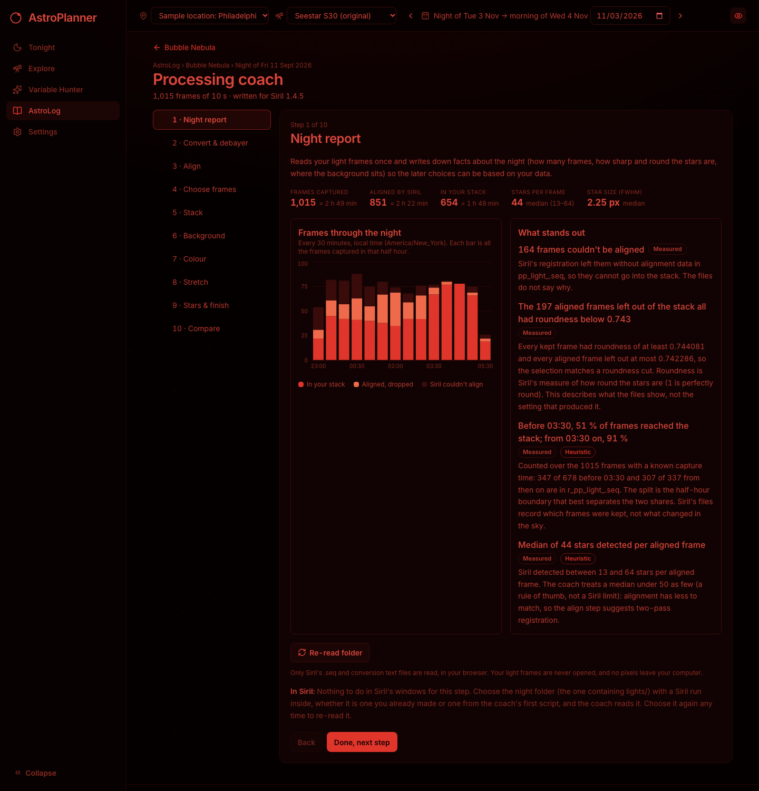

Screenshots are from a local run on the developer's own Bubble Nebula night. Methods, constants and sources are in
[docs/PROCESSING.md](docs/PROCESSING.md). Requires **Siril 1.4.5** to run the scripts (the app itself does not need
Siril installed). The coach does not use dark, flat or bias frames yet and says so when it finds those folders.

## Accuracy

All astronomy runs on the backend with **Astropy** and is checked in CI against independent
references (US Naval Observatory sunrise/sunset/twilight/moonrise data across both 2026 DST
transitions, a southern-hemisphere case and a midnight-sun case; USNO Moon phases; Meeus
Example 13.b). See [docs/ASTRONOMY.md](docs/ASTRONOMY.md) and [docs/SCORING.md](docs/SCORING.md).

## Run locally

Requirements: **Python 3.11+** (Astropy 8) and **Node 20+**.

```bash
./scripts/setup.sh     # creates backend/.venv, installs Python + npm dependencies
./scripts/dev.sh       # API on :8000, app on http://127.0.0.1:5173
```

Open http://127.0.0.1:5173 for the homescreen, or go straight to http://127.0.0.1:5173/tonight.

No API keys or environment variables are needed for the local prototype.

Or run the pieces yourself:

```bash
cd backend && .venv/bin/uvicorn app.main:app --reload --port 8000   # API + docs at /docs
cd frontend && npm run dev                                          # Vite, proxies /api
```

Single-process mode: after `npm run build`, the backend also serves `frontend/dist`
(`uvicorn app.main:app` → http://127.0.0.1:8000).

Optional environment variables:

| Variable | Default | Purpose |
|---|---|---|
| `DATABASE_URL` | unset → SQLite at `backend/data/astroplanner.db` | Postgres (e.g. Supabase) connection string |
| `ASTROPLANNER_DB` | `backend/data/astroplanner.db` | SQLite path when `DATABASE_URL` is unset |
| `ASTROPLANNER_PREVIEWS_DIR` | `backend/data/previews` | Where final-picture previews and thumbnails are stored |
| `ASTROPLANNER_SKY_IMAGES` | on | `off` stops all survey-picture downloads; target cards then show the framing diagram only |
| `ASTROPLANNER_SKY_CACHE_DIR` | `backend/data/sky-images` | Where survey pictures are cached (ignored by version control, never committed) |
| `ASTROPLANNER_CORS` | `http://localhost:5173,http://127.0.0.1:5173` | Allowed browser origins |

## Tests

```bash
cd backend && .venv/bin/python -m pytest -q        # 512 passed, 12 skipped (astronomy references, scoring, weather, sky images, API, AstroLog, Variable Hunter, Processing Coach, accounts and ownership, migrations)
cd frontend && npm run typecheck && npm test       # 385 tests: routes, landing page and city box, site pages, accounts (sign in, gates, Account page), location matching, time formatting, header slicing, import merge, night strip, sheets, Variable Hunter, Processing Coach, components
cd frontend && npm run build
cd frontend && npx playwright install chromium && npm run test:e2e   # 88 end-to-end runs over desktop + mobile (83 pass, 5 skipped: checks for one viewport only): landing page, site pages, accounts, Phase 1 smoke, AstroLog import, Variable Hunter, Processing Coach
```

The end-to-end suite starts its own backend (fresh SQLite file and preview folder under
`frontend/e2e/`) and Vite server on ports 8100/5180, so it never touches your dev servers or data.
To run two checkouts' suites at once, give one other ports: `E2E_API_PORT=8110 E2E_WEB_PORT=5190 npm run test:e2e`.
The landing page's city-box test uses live Open-Meteo geocoding and skips itself, with a reason, when that is unreachable.
It builds its FITS files itself with dummy coordinates (the Processing Coach test generates a synthetic night with
`backend/scripts/make_synthetic_night.py` into the git-ignored `frontend/e2e/fixtures/`). No test contacts AAVSO.

The 12 skipped backend tests are 11 local real-data checks (6 AstroLog, 5 Processing Coach; they need your own folders) and 1 Postgres migration test (runs when
`TEST_POSTGRES_URL` is set; CI provides it). To run the real-data acceptance checks against your own
folder of Seestar and Canon files (read-only, header slices only, prints no coordinates or serial numbers):

```bash
cd backend && ASTROPLANNER_REAL_DATA=<your folder> .venv/bin/python -m pytest tests/test_astrolog_real_data.py -v
```

Without the variable they are skipped, so CI never needs your files. The Processing Coach has the same kind of local check
(`ASTROPLANNER_REAL_NIGHT_DIR=<night folder> .venv/bin/python -m pytest tests/test_processing_real_data.py -v`; it reads `.seq`/conversion
text and FITS headers only).

Development follows the phased plan in [ROADMAP.md](ROADMAP.md); current status is in [PROGRESS.md](PROGRESS.md).

## Project layout

```
backend/   FastAPI + Astropy API (app/), tests/, scripts/build_catalog.py
frontend/  React + TypeScript + Vite + Tailwind UI
docs/      ARCHITECTURE.md · ASTRONOMY.md · SCORING.md · PROCESSING.md · screenshots/
scripts/   setup.sh · dev.sh
```

## Data sources and licenses

- **OpenNGC** (CC BY-SA 4.0): target coordinates, types, sizes, magnitudes. The derived
  `targets.json` is CC BY-SA 4.0; see [backend/app/data/ATTRIBUTION.md](backend/app/data/ATTRIBUTION.md).
- **Open-Meteo** Forecast and Geocoding APIs (data CC BY 4.0). The free tier is for
  **non-commercial use only**; review its terms before any commercial use.
- **AAVSO VSX** (catalog facts for four stars; personal, non-commercial use): see Variable Hunter above for the
  terms and attribution; facts are listed in
  [backend/app/data/ATTRIBUTION.md](backend/app/data/ATTRIBUTION.md).
- **Digitized Sky Survey** (STScI/DSS, POSS2/UKSTU red) pictures on target cards: fetched once per target, one at a time with back-off,
  cached locally and never committed or redistributed. Credit: STScI/DSS. Turn off with `ASTROPLANNER_SKY_IMAGES=off`.
- **Astropy** (BSD-3-Clause), **timezonefinder** (MIT), **photutils** (BSD-3-Clause; star size in stack measurements).
- **Siril** (GPL-3.0) is run by the user, never bundled; the coach writes scripts and reads Siril's own text output, and copies no
  Siril code or documentation text. Sources: [docs/PROCESSING.md](docs/PROCESSING.md).
- Seestar S30 specifications: [manufacturer product page](https://us.seestar.com/products/seestar-s30-all-in-one-smart-telescope).
  The published 2.46° FOV does not state its axis, so framing notes are approximate.

Scores are heuristic planning estimates, not measurements of sky quality, transparency or seeing.
