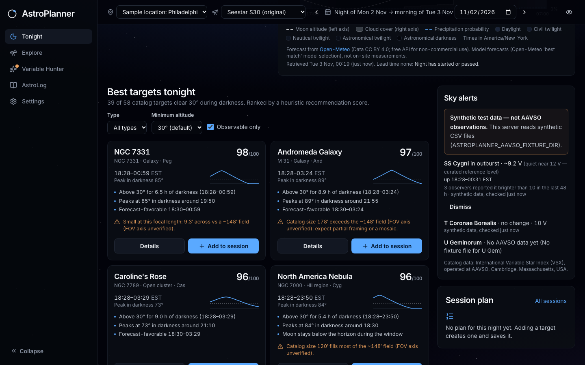

# AstroPlanner

**Explore. Capture. Discover.** An astrophotography planner built around one question:
*which targets will actually be above my horizon during real darkness tonight, and when?*
It is tuned first for the **ZWO Seestar S30** (original, not the S30 Pro).


## What it does (Phase 1)

- **Tonight:** a 0–100 **Tonight's Score** with every component shown (cloud 45, rain 25,
  Moon 20, darkness 10), whether each is *forecast* or *calculated*, and the best 2-hour
  window. The dusk-to-dawn timeline shows twilight bands, Moon altitude and hourly cloud and
  precipitation. With no forecast, there is **no total**, only clearly labelled partial
  indicators.
- **Recommendations:** 58 deep-sky targets from OpenNGC, ranked by a transparent heuristic.
  Each shows its real observing window, peak altitude, Moon separation, 2–4 reasons and
  cautions (including S30 framing notes).
- **Explore:** search and filter the full catalog. A detail drawer shows the
  altitude-vs-local-time chart, coordinates, rise/set and the score breakdown.
- **Sessions:** create a plan for a night; add, reorder and remove targets; it persists in the database.
- **Settings:** city search or manual coordinates with timezone detection (opt-in browser
  geolocation), the read-only **verified S30 preset** plus custom equipment, and observing
  preferences (minimum altitude, astronomical vs nautical darkness).
- **Night vision:** one toggle turns the whole app dim red to protect dark-adapted eyes at the telescope.


## AstroLog (Phase 2)

A target-first library of what you have actually shot. Import a folder of **Seestar S30 FITS**
or **Canon CR2** files and AstroLog reads only each file's header: in your browser, never the
image data. It groups frames into nights (local noon to noon) and capture sets, and shows for
every target the **time in the final stack** (or the **captured** time, labelled as such) beside
your finished picture.

- **Library** (`/astrolog`): one tile per target with the final picture, headline time and number of nights.
- **Target page:** final picture, time on target, "654 of 1,012 frames used" when the stack's frame range is known
  (the denominator is the captured frames inside that stack's EXPSTART–EXPEND), header-derived facts with the header
  key each came from (Canon: camera, lens, exposure, ISO, f-number, focal length from EXIF), and the nights that
  contributed with their local first → last frame times and per-frame exposure. Upload a final picture
  (JPEG, PNG, TIFF or FITS, up to 150 MB) and link it to the stack it came from. Only a
  metadata-free preview (about 1600 px) and a thumbnail are kept.
- **Import** (`/astrolog/import`): choose or drop a folder, review what was found, then commit. Re-importing a
  folder after adding frames adds only the new ones; nothing doubles. Unreadable files are listed as skipped with a reason.
- **Nights** (`/astrolog/nights`): sessions as logs, attached to a plan you made in Tonight when one matches. Planned targets you did not shoot are shown as "not shot". A night with imported captures can't be deleted.
- **Unsorted:** there is one Unsorted group. "Move to Unsorted" on a custom target merges it into that group.
- **Planner badge:** Tonight and Explore cards show "You have 1 h 49 m stacked" (or "captured") for targets already in your library.
- **Privacy:** coordinates inside files are used only to pick a saved location and are never stored or returned.
  Unknown values stay "unknown"; nothing is estimated. Stacks are never summed.


## Variable Hunter (Phase 3)

A short, curated list of variable stars a Seestar can follow: **SS Cygni, U Geminorum, T Coronae Borealis, R Leonis**
(`/variables`; the old `/research` address redirects there).

- **Star page** (`/variables/:slug`): type and VSX magnitude range, tonight's window above your minimum altitude
  (calculated for your saved location), your own nights from AstroLog, and a **light curve of AAVSO observations**
  with brighter at the top, V and visual points kept apart, a daily-average line, your imaged nights marked, and a
  line saying where the data came from, how many observations are cached and when it was last checked.
- **Sky alerts** on Tonight (and a dot on the menu item): a star is called out only when at least 2 independent observers
  (3 for T CrB) report it brighter than its threshold within 48 hours. Every row says how fresh its data is; a
  failed or old fetch reads "Stale" or "No AAVSO data yet", never "no change". There are **no predictions**: no
  eruption dates, countdowns or "expected" text.
- **Missions** (outburst, weekly watch, follow the cycle) are counted from your own AstroLog nights.
- **Seestar fit** uses an **estimated** S30 brightness range of 7 to 12.5, labelled "estimate, not yet measured".





**The AAVSO layer is off by default.** Without it the app still lists the stars, computes their visibility and links to
the star's VSX page; it just shows no light curve and no alerts. To switch it on for local, personal use:

```bash
ASTROPLANNER_AAVSO_ENABLED=1 ./scripts/dev.sh      # or export it before starting uvicorn
```

Why off by default: VSX's copyright page (read 2026-11-02) permits "personal, non-commercial use only" and forbids
mirroring on another server without permission. AAVSO's Data Usage Guidelines and its API documentation on
`www.aavso.org` have **not been read** (a browser challenge blocks automated readers), so using the layer locally is
your decision, and **a public deployment needs AAVSO's written permission first**. The app only ever calls
`vsx.aavso.org`, one request at a time, at least 2 seconds apart, with an honest user agent. Observer names, countries,
comments and chart IDs are never stored; the observer code is kept only as a salted hash used to count distinct observers.

Attribution shown with the data: "Catalog data: International Variable Star Index (VSX), operated at AAVSO, Cambridge,
Massachusetts, USA." and "Observations from the AAVSO International Database, contributed by observers worldwide. © AAVSO."

## Accuracy

All astronomy runs on the backend with **Astropy** and is checked in CI against independent
references (US Naval Observatory sunrise/sunset/twilight/moonrise data across both 2026 DST
transitions, a southern-hemisphere case and a midnight-sun case; USNO Moon phases; Meeus
Example 13.b). See [docs/ASTRONOMY.md](docs/ASTRONOMY.md) and [docs/SCORING.md](docs/SCORING.md).

## Run locally

Requirements: **Python 3.11+** (Astropy 8) and **Node 20+**.

```bash
./scripts/setup.sh     # creates backend/.venv, installs Python + npm dependencies
./scripts/dev.sh       # API on :8000, app on http://127.0.0.1:5173
```

No API keys or environment variables are needed for the local prototype.

Or run the pieces yourself:

```bash
cd backend && .venv/bin/uvicorn app.main:app --reload --port 8000   # API + docs at /docs
cd frontend && npm run dev                                          # Vite, proxies /api
```

Single-process mode: after `npm run build`, the backend also serves `frontend/dist`
(`uvicorn app.main:app` → http://127.0.0.1:8000).

Optional environment variables:

| Variable | Default | Purpose |
|---|---|---|
| `DATABASE_URL` | unset → SQLite at `backend/data/astroplanner.db` | Postgres (e.g. Supabase) connection string |
| `ASTROPLANNER_DB` | `backend/data/astroplanner.db` | SQLite path when `DATABASE_URL` is unset |
| `ASTROPLANNER_PREVIEWS_DIR` | `backend/data/previews` | Where final-picture previews and thumbnails are stored |
| `ASTROPLANNER_AAVSO_ENABLED` | unset (off) | `1` switches on live AAVSO observations (local personal use; see Variable Hunter above) |
| `ASTROPLANNER_AAVSO_FIXTURE_DIR` | unset | Read synthetic VSX-format CSV files (`<slug>.csv`) instead of calling AAVSO; used by the e2e tests |
| `ASTROPLANNER_CORS` | `http://localhost:5173,http://127.0.0.1:5173` | Allowed browser origins |

## Tests

```bash
cd backend && .venv/bin/python -m pytest -q        # 295 passed, 7 skipped (astronomy references, scoring, weather, API, AstroLog, Variable Hunter, migrations)
cd frontend && npm run typecheck && npm test       # 101 tests: time formatting, header slicing, import merge, light curve, sky alerts, components
cd frontend && npm run build
cd frontend && npx playwright install chromium && npm run test:e2e   # 24 end-to-end tests (Phase 1 smoke, AstroLog import, Variable Hunter), desktop + mobile
```

The end-to-end suite starts its own backend (fresh SQLite file and preview folder under
`frontend/e2e/`) and Vite server on ports 8100/5180, so it never touches your dev servers or data.
It builds its FITS files itself with dummy coordinates. Tests tagged `@fixture` run against a second backend
(8101, Vite 5181) that reads synthetic AAVSO CSV files written by `frontend/e2e/make-aavso-fixtures.mjs`
just before it starts (times relative to now, so the alert window is always current; the files are gitignored).
No test contacts AAVSO.

The 7 skipped backend tests are 6 local real-data checks and 1 Postgres migration test (runs when
`TEST_POSTGRES_URL` is set; CI provides it). To run the real-data acceptance checks against your own
folder of Seestar and Canon files (read-only, header slices only, prints no coordinates or serial numbers):

```bash
cd backend && ASTROPLANNER_REAL_DATA=<your folder> .venv/bin/python -m pytest tests/test_astrolog_real_data.py -v
```

Without the variable they are skipped, so CI never needs your files.

Development follows the phased plan in [ROADMAP.md](ROADMAP.md); current status is in [PROGRESS.md](PROGRESS.md).

## Project layout

```
backend/   FastAPI + Astropy API (app/), tests/, scripts/build_catalog.py
frontend/  React + TypeScript + Vite + Tailwind UI
docs/      ARCHITECTURE.md · ASTRONOMY.md · SCORING.md · screenshots/
scripts/   setup.sh · dev.sh
```

## Data sources and licenses

- **OpenNGC** (CC BY-SA 4.0): target coordinates, types, sizes, magnitudes. The derived
  `targets.json` is CC BY-SA 4.0; see [backend/app/data/ATTRIBUTION.md](backend/app/data/ATTRIBUTION.md).
- **Open-Meteo** Forecast and Geocoding APIs (data CC BY 4.0). The free tier is for
  **non-commercial use only**; review its terms before any commercial use.
- **AAVSO VSX** (star facts) and the **AAVSO International Database** (observations, only when switched on):
  see Variable Hunter above for the terms and attribution; facts are listed in
  [backend/app/data/ATTRIBUTION.md](backend/app/data/ATTRIBUTION.md).
- **Astropy** (BSD-3-Clause), **timezonefinder** (MIT).
- Seestar S30 specifications: [manufacturer product page](https://us.seestar.com/products/seestar-s30-all-in-one-smart-telescope).
  The published 2.46° FOV does not state its axis, so framing notes are approximate.

Scores are heuristic planning estimates, not measurements of sky quality, transparency or seeing.
